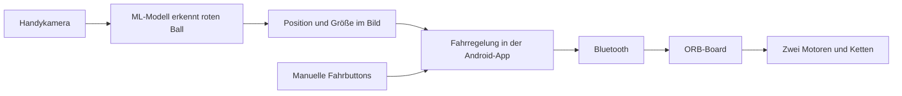

# ARP – Android Robotic Project

Ein kettengetriebener Roboter soll einem roten Ball selbstständig folgen. Ein am Roboter befestigtes Android-Smartphone liefert die Kamerabilder, erkennt den Ball mit Machine Learning und berechnet die Fahrbefehle. Über Bluetooth sendet die App diese Befehle an das Open Robotic Board (ORB), das die beiden Antriebsmotoren steuert.

Das Projekt verbindet Android-Entwicklung in Java, mobile Objekterkennung und die Steuerung eines realen Roboters. Der Code soll überschaubar bleiben, damit sich der Ablauf vom Kamerabild bis zur Bewegung nachvollziehen lässt.

## Projektstand

Stand der Dokumentation ist der 18. November 2026. Die manuelle Steuerung ist implementiert. Kamera, ML-Modell und autonomes Folgen sind geplant.

| Funktion | Stand |
| --- | --- |
| Gekoppelten Roboter auswählen und über Bluetooth verbinden | Implementiert, Test mit echter Hardware steht aus |
| Vorwärts und rückwärts fahren, solange die Taste gedrückt wird | Implementiert, Motorpakete im Emulator geprüft |
| Beim Loslassen, Touch-Abbruch oder Fokusverlust stoppen | Implementiert, im Emulator geprüft |
| Kameravorschau auf dem Handy | Geplant |
| Roten Ball mit einem ML-Modell erkennen | Geplant |
| Zum Ball lenken und den Abstand regeln | Geplant |
| Bei verlorenem Ball oder veralteten Kamerabildern anhalten | Für den Automatikbetrieb geplant |

Am 17. November 2026 wurden die Debug-APK und Android Lint erfolgreich ausgeführt. Lint meldete 11 Warnungen. Der Emulator-Test prüfte je Richtung 25 aufeinanderfolgende Motorbefehle bei stillgehaltenem Finger, anschließend den Stopp sowie Abbruch, zweiten Finger und Fokusverlust. Die Bluetooth-Übertragung wurde dabei simuliert. Fahrverhalten, Drehrichtung und Anhalteweg müssen am echten Roboter geprüft werden.

Seit dem 18. November 2026 ist ein wiederholbarer Android-Test im Projekt enthalten. Alle fünf Tests wurden im Emulator erfolgreich ausgeführt. Bei jeweils zehn Sekunden Halten entstanden 96 Vorwärts- und 95 Rückwärtsbefehle. Der größte gemessene Abstand betrug 240 ms. Loslassen, Touch-Abbruch, Fokusverlust und Pausieren lösten jeweils den Stopp aus. Die Anleitung beschreibt den Start direkt in Android Studio. [Ohne Roboter testen](ButtonDemo/README.md#ohne-roboter-testen)

## Hardware und Aufbau

Die Planung orientiert sich am mBot Ranger aus den Kursunterlagen.

| Bestandteil | Aufgabe |
| --- | --- |
| Kettenfahrwerk mit zwei Motoren | Linke und rechte Kette unabhängig antreiben |
| Open Robotic Board mit Bluetooth-Verbindung | Fahrbefehle empfangen und Motoren ansteuern |
| Android-Smartphone mit Rückkamera | Kamerabild aufnehmen, Ball erkennen und Fahrbefehle berechnen |
| Feste Handyhalterung | Kamera nach vorne ausrichten und Bildbewegungen verringern |
| Stromversorgung des Roboters | Board und Motoren versorgen |
| Roter Ball | Zielobjekt für Erkennung und Verfolgung |

Die vorhandene App verwendet die Motoranschlüsse M1 und M4. Beim Aufbau werden die Zuordnung zur linken und rechten Kette sowie die Drehrichtungen überprüft. Für die ersten Versuche ist ein ebener Innenbereich mit freier Fahrfläche vorgesehen.

## Zusammenspiel der Komponenten

Der folgende Ablauf beschreibt den geplanten Automatikbetrieb.



Das Handy übernimmt die Bildauswertung und die Entscheidung über die Bewegung. Das Board setzt die empfangenen Motorwerte um. Bei unterschiedlichen Geschwindigkeiten der beiden Ketten fährt der Roboter eine Kurve.

## App starten

Die vorhandene Steuerungs-App wurde mit JDK 21 und Android SDK 35 gebaut. Für die Entwicklung wird Android Studio verwendet. Die App unterstützt Android ab Version 6. Für Bluetooth- und Fahrtests wird ein echtes Android-Handy mit dem Roboter verwendet.

1. Das Repository herunterladen oder klonen.

   ```sh
   git clone https://github.com/romwo32/ARP.git
   ```

2. In Android Studio den Ordner `ARP/ButtonDemo` öffnen.
3. Als Gradle-JDK JDK 21 auswählen und den Gradle-Sync ausführen.
4. Das Handy mit aktiviertem USB-Debugging anschließen und die App starten.
5. Bluetooth am Handy einschalten und den Roboter in den Android-Einstellungen koppeln.
6. In der App **Verbinden** antippen, den angefragten Zugriff auf Geräte in der Nähe erlauben und den Roboter auswählen.
7. **Vorwärts** oder **Rückwärts** gedrückt halten. Beim Loslassen sendet die App einen Stoppbefehl.

Der Build lässt sich auch im Terminal im Ordner `ButtonDemo` ausführen. Unter Windows mit eingerichtetem `JAVA_HOME` und Android-SDK lautet der Aufruf

```powershell
.\gradlew.bat assembleDebug lintDebug
```

Die APK entsteht unter `ButtonDemo/app/build/outputs/apk/debug/app-debug.apk`. Den lokalen SDK-Pfad verwaltet Android Studio in `local.properties`.

## Vorhandene Fahrsteuerung

Beim Aufsetzen des Fingers startet die App sofort die Bewegung. Solange die Taste gehalten wird, erneuert sie den Motorbefehl alle 100 ms. Das funktioniert auch bei einem unbewegten Finger. Beim Loslassen beendet sie die Wiederholung und setzt beide Motorwerte auf null.

| Richtung | M1 | M4 |
| --- | --- | --- |
| Vorwärts | +1500 | −1500 |
| Rückwärts | −1500 | +1500 |
| Stopp | 0 | 0 |

Die Vorzeichen berücksichtigen die spiegelverkehrte Montage der Motoren. Die Werte werden im `SPEED_MODE` übertragen. Auch ein zweiter Finger, ein Touch-Abbruch oder das Verlassen der App beendet die Fahrt. Während ein Fahrbutton gehalten wird, bleibt der Bildschirm eingeschaltet.

Nach einem Funkabbruch kann die App einen Stoppbefehl nicht zuverlässig zustellen. Das Verhalten des Boards bei ausbleibenden Fahrbefehlen ist deshalb Teil des Hardwaretests.

Der Ablauf ist direkt in der Activity umgesetzt. Eine kurze Erklärung der Methoden steht in der App-Anleitung. [MainActivity.java](ButtonDemo/app/src/main/java/com/hbrs/MainActivity.java) · [App-Anleitung](ButtonDemo/README.md)

## Geplante Ballverfolgung mit Machine Learning

Für die Erkennung ist ein kleines Objekterkennungsmodell mit der Klasse `roter_ball` vorgesehen. Eigene Aufnahmen zeigen den Ball aus unterschiedlichen Entfernungen, Blickwinkeln und bei verschiedenen Lichtverhältnissen. Die Position des Balls wird in jedem Trainingsbild mit einem Rechteck markiert. Aufnahmen ohne Ball und mit anderen roten Gegenständen ergänzen den Datensatz.

Das Modell wird am Entwicklungsrechner trainiert oder angepasst und anschließend auf dem Handy ausgeführt. Es soll die Position des Balls und einen Konfidenzwert liefern, der die Sicherheit der Erkennung beschreibt. Modell und Laufzeit werden anhand der Geschwindigkeit und Erkennungsqualität auf dem verwendeten Handy ausgewählt. LiteRT bietet einen möglichen Weg, ein passendes Modell in eine Java-Android-App einzubinden. [Google AI Edge – Objekterkennung](https://developers.google.com/edge/litert/libraries/task_library/object_detector)

CameraX soll die Vorschau und die Bilder für die Analyse bereitstellen. Die Analyse verarbeitet jeweils das aktuelle Bild im Hintergrund. Dadurch können Bildauswertung und Bedienoberfläche unabhängig arbeiten. [Android Developers – CameraX Image Analysis](https://developer.android.com/media/camera/camerax/analyze)

Die geplante Fahrregelung verwendet die horizontale Position des Balls zum Lenken. Die Größe des Balls im Bild dient als Anhaltspunkt für den Abstand. Dafür werden Ballgröße, Kameraposition und gewünschter Abstand am aufgebauten Roboter abgeglichen.

| Beobachtung | Geplantes Verhalten |
| --- | --- |
| Ball mittig und weiter entfernt | Langsam vorwärtsfahren |
| Ball links oder rechts | Zum Ball drehen oder eine Kurve fahren |
| Ball im gewünschten Abstand oder näher | Anhalten |
| Ball fehlt, Erkennung ist unsicher oder Bild ist zu alt | Anhalten und auf eine gültige Erkennung warten |
| Automatik wird beendet oder App verliert den Fokus | Motorwerte auf null setzen |

Der Automatikbetrieb soll ausdrücklich gestartet werden. Eine manuelle Fahrbetätigung beendet ihn. Der Wechsel zurück zur Automatik erfolgt durch erneutes Starten. Damit bleibt erkennbar, welcher Bedienvorgang eine Bewegung auslöst.

## Projektplan

Der vorgeschlagene Ablauf umfasst sechs Wochen. Die Termine werden an Abgabe, Teamgröße und verfügbare Hardware angepasst.

| Woche | Ergebnis |
| --- | --- |
| 1 | Aufbau, Motorzuordnung und Halte-Steuerung am echten Roboter geprüft |
| 2 | Kameravorschau und Bildanalyse auf dem Handy laufen |
| 3 | Datensatz erstellt und erstes ML-Modell trainiert |
| 4 | Ballposition und Erkennungssicherheit werden auf dem Handy angezeigt |
| 5 | Roboter folgt dem Ball mit begrenzter Geschwindigkeit und hält bei Zielverlust an |
| 6 | Gesamtsystem getestet, Ergebnisse dokumentiert und Vorführung vorbereitet |

Arbeitspakete, Abnahmetests und offene Entscheidungen stehen im Projektplan. [Projektplan](PROJEKTPLAN.md)

## Dateien im Repository

| Pfad | Inhalt |
| --- | --- |
| `ButtonDemo/` | Android-Projekt mit der manuellen Fahrsteuerung |
| `ButtonDemo/app/src/main/java/com/hbrs/MainActivity.java` | Bedienung, Bluetooth-Verbindung und Fahrbefehle |
| `ButtonDemo/app/src/main/java/com/hbrs/ORB/` | ORB-Kommunikation und Motorprotokoll aus dem Kursmaterial mit Anpassungen |
| `ButtonDemo/app/src/main/res/layout/activity_main.xml` | Oberfläche der App |
| `PROJEKTPLAN.md` | Entwicklungsschritte und Testplan |
| `androidrobotokseminar.zip`, `bi-androidroboticproject-main (2).zip` | Frühere Projektstände und Kursmaterial |

## Lizenz und Grundlagen

Das Repository enthält eine MIT-Lizenz. Die ORB-Klassen stammen aus dem Kursmaterial von Thomas Breuer. Die Herkunftshinweise stehen in den Quelldateien. [Lizenz](LICENSE)
